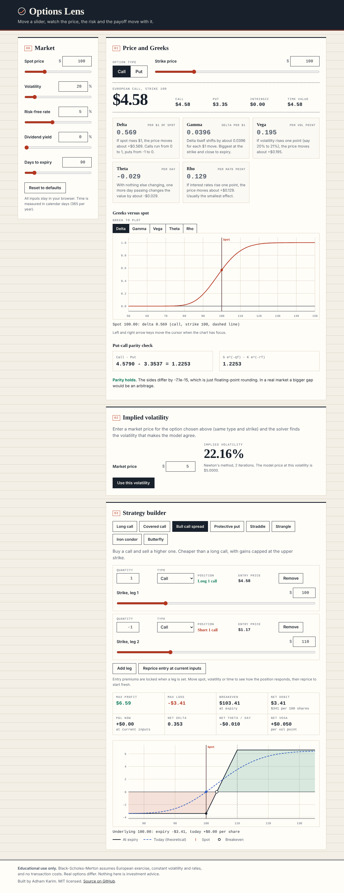

# Options Lens

Price a European option, read its Greeks in plain English, solve implied volatility and watch multi-leg strategy payoffs respond to every slider, all in one static page with no dependencies.



## Live demo

Enable GitHub Pages for your copy of the repo (Settings, Pages, deploy from branch `main`, root folder). The app is then served at:

https://adhamkarim4815.github.io/options-lens/

## Features

- Black-Scholes-Merton pricer for European calls and puts with a continuous dividend yield
- Live Greeks (delta, gamma, vega, theta per day, rho), each with a one-line explanation that uses your current numbers
- Greeks-versus-spot chart, with a cursor you can drag or move with the arrow keys
- Implied volatility solver (Newton's method with a bisection fallback) from a market price
- Put-call parity check
- Strategy builder with presets: long call, covered call, bull call spread, protective put, straddle, strangle, iron condor, butterfly. Edit legs, strikes and quantities freely
- Payoff-at-expiry diagram plus a "today" theoretical value curve, max profit, max loss, breakevens, net debit or credit and net Greeks
- Sliders for spot, strike, volatility, rate, dividend yield and days to expiry that update everything live
- Light and dark themes (follows your system), responsive down to phone width, keyboard accessible, no network calls

## Run locally

There is nothing to install or build. Either open `index.html` directly (it works from `file://`) or serve the folder:

```sh
python3 -m http.server 8000
# then visit http://localhost:8000
```

Browsers refuse ES module scripts on `file://`, so `index.html` loads `src/app.classic.js` in that case. That file is the same source concatenated into one plain script by `scripts/bundle.mjs`. Over http(s) the real ES modules in `src/` are used. If you edit anything in `src/`, regenerate the bundle with `npm run bundle`; a test fails if it is out of date.

## Formulas

With spot `S`, strike `K`, rate `r`, dividend yield `q`, volatility `sigma`, time `T` in years (days / 365) and standard normal CDF `N` and density `n`:

```
d1 = ( ln(S/K) + (r - q + sigma^2 / 2) T ) / ( sigma sqrt(T) )
d2 = d1 - sigma sqrt(T)

Call = S e^(-qT) N(d1) - K e^(-rT) N(d2)
Put  = K e^(-rT) N(-d2) - S e^(-qT) N(-d1)

delta (call) =  e^(-qT) N(d1)          delta (put) = -e^(-qT) N(-d1)
gamma        =  e^(-qT) n(d1) / (S sigma sqrt(T))
vega         =  S e^(-qT) n(d1) sqrt(T)
theta (call) = -S e^(-qT) n(d1) sigma / (2 sqrt(T)) - r K e^(-rT) N(d2) + q S e^(-qT) N(d1)
theta (put)  = -S e^(-qT) n(d1) sigma / (2 sqrt(T)) + r K e^(-rT) N(-d2) - q S e^(-qT) N(-d1)
rho (call)   =  K T e^(-rT) N(d2)      rho (put)   = -K T e^(-rT) N(-d2)

Put-call parity: Call - Put = S e^(-qT) - K e^(-rT)
```

Displayed units: vega per 1 volatility point, theta per calendar day, rho per 1 rate point, delta and gamma per $1 of spot.

Implied volatility solves `price(sigma) = market price` with Newton's method seeded by the Brenner-Subrahmanyam estimate. The root is kept inside a bracket, and any step that leaves the bracket, or meets a vanishing vega, becomes a bisection step. Prices below the lowest or above the highest value an option can have are reported as having no solution.

Strategy analysis is exact rather than sampled. A payoff at expiry is piecewise linear with kinks at the strikes, so max profit, max loss and breakevens come from the kinks plus the slope beyond the last strike. A position has unlimited profit or loss when that final slope is positive or negative. Entry premiums are priced with the model when a leg is set and then stay locked, so moving spot, volatility or time shows how the position's value changes.

## Tests

```sh
node --test
```

Uses only the built-in Node test runner (Node 20 or newer). 59 tests cover reference prices (including S=100, K=100, r=5%, sigma=20%, T=1: call 10.4506, put 5.5735), put-call parity, every Greek against finite differences, implied-volatility round trips and bracket fallback, edge cases (T at or near 0, zero volatility, deep in and out of the money), max profit, max loss and breakevens for each preset checked against closed forms and a brute-force scan, and bundle freshness.

## Layout

```
index.html              page structure
src/styles.css          theme and layout
src/app.js              UI and hand-drawn SVG charts (no libraries)
src/bs.js               Black-Scholes-Merton, Greeks, implied volatility, parity (pure, no DOM)
src/strategy.js         legs, payoff, today curve, analysis, presets (pure, no DOM)
src/app.classic.js      generated plain-script bundle for file:// (npm run bundle)
scripts/bundle.mjs      the bundler
tests/                  node --test suites
docs/screenshot.png     screenshot used above
```

## Limitations

This is an educational tool, not investment advice. It models European exercise only, so American options (most US equity options) can be worth more, especially puts and dividend-paying calls. It assumes constant volatility, rate and dividend yield, no transaction costs or taxes, and a single volatility for every leg (no smile or skew). Dividends are a continuous yield, not discrete payments. Money values are per share and shown in dollars for simplicity. Do not use it to make trading decisions.

## License

MIT, see [LICENSE](LICENSE). Built by Adham Karim.
